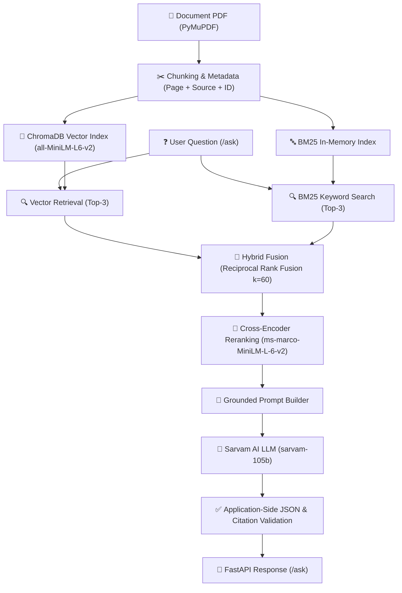

# Ask My Docs — Production-Grade RAG

A production-oriented Retrieval-Augmented Generation (RAG) system built to provide grounded, citation-backed answers from uploaded document sets while preventing hallucinations and enforcing automated CI quality gates.

---

## 🏗️ Architecture



---

## 🌟 Key Features

* **Hybrid Retrieval Pipeline**: Combines semantic dense retrieval (ChromaDB + `all-MiniLM-L6-v2`) with sparse keyword retrieval (BM25) using **Reciprocal Rank Fusion (RRF)**.
* **Cross-Encoder Reranking**: Utilizes `cross-encoder/ms-marco-MiniLM-L-6-v2` to compute deep query-document cross-attention relevance scores, ensuring top-3 candidates are strictly relevant.
* **Grounded Answers & Citation Mapping**: Strict prompt rules force the LLM to cite specific context IDs `[Context 1]`, which are validated and mapped back to source PDF page numbers in the API response.
* **Hallucination Prevention**: Automatically returns `"I could not find the answer in the provided documents."` with an empty citations list (`[]`) for unanswerable questions.
* **Ragas Evaluation & Automated CI Quality Gate**: Includes an evaluation suite measuring **Faithfulness (1.00)** and **Context Recall (1.00)**, integrated into GitHub Actions CI to block pull requests if quality drops below 0.80.
* **Production FastAPI & Docker**: Fully containerized RESTful API with Pydantic request validation and structured exception handling.

---

## 📊 Ragas Evaluation Metrics

The system was evaluated against a human-verified ground-truth dataset across key RAG benchmarks:

| Metric | Score | Description |
|---|---|---|
| **Faithfulness** | **1.00 (100%)** | Measures whether generated answers rely strictly on retrieved context without hallucinating. |
| **Context Recall** | **1.00 (100%)** | Measures whether hybrid retrieval successfully retrieved all facts required by ground truth. |

---

## 🚀 Quick Start

### 1. Prerequisites
* Python 3.13+
* Git
* Sarvam AI API Key (`SARVAM_API_KEY`)

### 2. Environment Setup
```bash
# Clone repository
git clone https://github.com/your-username/ask-my-docs.git
cd ask-my-docs

# Create and activate virtual environment
python -m venv venv
venv\Scripts\activate      # Windows
# source venv/bin/activate # Linux/macOS

# Install dependencies
pip install -r requirements.txt
```

### 3. Environment Variables
Create a `.env` file in the root folder:
```env
SARVAM_API_KEY=your_sarvam_api_key_here
```

### 4. Run FastAPI Application
```bash
uvicorn app.main:app --reload
```
Access Swagger UI documentation at: `http://127.0.0.1:8000/docs`

---

## 🧪 Testing & Quality Gates

Run full test suite (API Unit Tests + Quality Gate):
```bash
pytest
```

Run evaluation script:
```bash
python tests/evaluate_rag.py
```

---

## 🐳 Docker Deployment

### Build Docker Image
```bash
docker build -t ask-my-docs:latest .
```

### Run Container
```bash
docker run -d -p 8000:8000 --env-file .env --name ask-my-docs ask-my-docs:latest
```

---

## 💡 Important Technical Decisions & Trade-offs

1. **Why Hybrid Retrieval (BM25 + Vector)?**
   * Dense vector search excels at semantic meaning (e.g. "selection process" ~ "hiring rounds").
   * Sparse BM25 search excels at exact keyword matching (e.g. "Round 1", "HR").
   * Combining both via Reciprocal Rank Fusion (RRF) eliminates failure modes of single-retriever systems.

2. **Why Cross-Encoder Reranking?**
   * Bi-encoders (vector embeddings) compute query and document representations independently.
   * Cross-encoders process query and context simultaneously, capturing nuanced interaction features at the cost of higher latency. Applying reranking only to top candidate chunks balances accuracy and speed.

3. **Application-Side Response Validation**:
   * Relying purely on LLM prompt instructions for JSON structure or citation IDs can fail in production.
   * Application-level schema validation (`validate_rag_response`) enforces type checks and valid context ID bounds before returning data to users.
